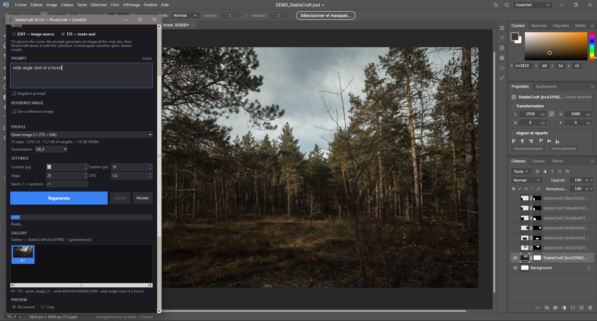
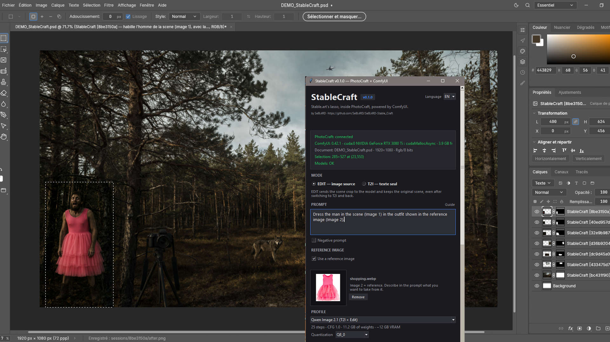
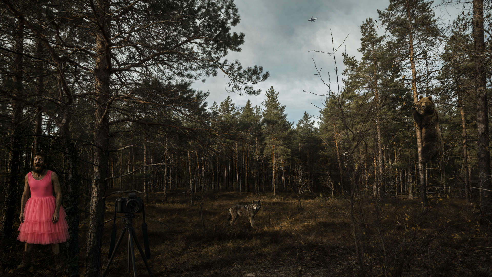

# StableCraft

**L'édition par lasso de Stable.art, dans PhotoCraft, avec ComfyUI.**

StableCraft est une application compagne pour PhotoCraft : on entoure une zone au
lasso, on décrit le changement, et le résultat arrive dans un **nouveau calque masqué**.
Tout tourne en local, sur son propre GPU, avec ComfyUI comme moteur de génération.


## Présentation

- lasso → prompt → édition → calque PhotoCraft ;
- calque avec **masque et feather** ;
- **galerie persistante par calque** : régénérer, comparer, changer de génération,
  favoris ;
- génération par lot jusqu'à 16 images, appliquées dès qu'elles sont prêtes ;
- outil **XYZ Plot** (sampler, scheduler, steps, denoise, LoRA, CFG, prompt S/R) ;
- image de référence ;
- régénération possible même si la sélection a été perdue ;
- **deux modes** : EDIT (image source) ou T2I (texte seul), EDIT par défaut ;
- **gestion des LoRA** avec une UI ergonomique et des miniatures ;
- **5 modèles disponibles** pour le moment ;
- gestionnaire de modèles à la demande (**Localiser** / **Télécharger**) et vérification
  automatique du nœud `comfyui-krea2edit` ;
- UI anglais/français, anglais par défaut.


<a href="./demo/t2i_forest.png" target="_blank"></a> <a href="./demo/DEMO_StableCraft_EDIT.jpg" target="_blank"></a>


<a href="./demo/DEMO_full.jpg" target="_blank">
  
</a>

## Fondement

StableCraft ne modifie pas PhotoCraft et n'est pas un fork.

PhotoCraft est piloté par son **control channel local** : lecture de la sélection,
sauvegarde du composite, insertion du calque, création du masque. ComfyUI est piloté en
HTTP. Les deux applications restent indépendantes et peuvent être mises à jour
séparément. La compatibilité est vérifiée par les commandes disponibles, pas par un
numéro de version figé.

## Dépendances

### Matériel

- Windows 10/11 **x64**, ou Linux **x86_64**.
- GPU **NVIDIA** seulement, pour le moment.
- **12 Go de VRAM** testés sur RTX 3080 Ti ; 32 Go de RAM.
- En dessous de 12 Go de VRAM, ce n'est pas validé aujourd'hui.
- Sous Linux, AMD/ROCm peut fonctionner via ComfyUI mais n'est pas validé par
  StableCraft.

### Logiciel

- **PhotoCraft 0.16.0** ou supérieur (portable ou installé).
- **ComfyUI portable** sous Windows (avec `python_embeded\python.exe`), récent :
  `0.42.1+` pour Qwen Image 2.1 et les nœuds Krea 2.
- Sous Linux, **ComfyUI** via Comfy Desktop, une installation manuelle en venv, ou
  `comfy-cli standalone`. Il n'existe pas de `python_embeded` Linux officiel.
- **Python 3.11+** avec **Tkinter** (l'installateur python.org l'inclut sous Windows ;
  Linux fournit Tkinter dans un paquet séparé).
- Pour Krea 2 : le nœud custom
  [`comfyui-krea2edit`](https://github.com/lbouaraba/comfyui-krea2edit).
- `ComfyUI-GGUF` pour charger les modèles UNet GGUF.
- Optionnel : le nœud custom
  [`ComfyUI-Lora-Manager`](https://github.com/willmiao/ComfyUI-Lora-Manager) pour la
  liste et les miniatures des LoRA. Sans lui, StableCraft retombe sur la liste LoRA de
  ComfyUI, sans miniatures.

### Modèles

Les poids ne sont **pas** fournis. Ils doivent être visibles par ComfyUI.
StableCraft peut localiser ou télécharger les fichiers manquants à la demande, avec
confirmation explicite.

| Profil | UNet | Text encoder | VAE | Steps / CFG |
|---|---|---|---|---|
| **FLUX.3 Klein** (défaut) | `flux-3-image-klein-Q8_0.gguf` | `qwen3vl_4b_fp8_scaled.safetensors` | `flux2_vae.safetensors` | 16 / 1.0 |
| **FLUX.2 Klein 9B** | `flux-2-klein-Distilled-9b-Q8_0.gguf` | `Qwen3-8B-Q4_K_M.gguf` | `flux2_vae.safetensors` | 4 / 1.0 |
| **Krea 2 General Edit** | `krea2_turbo_fp8_scaled.safetensors` + `krea2_general_edit_v2.safetensors` | `qwen3vl_4b_fp8_scaled.safetensors` | `qwen_image_vae.safetensors` | 8 / 1.0 |
| **Krea 2 Identity Edit** | `krea2_turbo_edit-Q4_K_M.gguf` (Q6_K / Q8_0 disponibles) | `qwen3vl_4b_fp8_scaled.safetensors` | `qwen_image_vae.safetensors` | 8 / 1.0 |
| **Qwen Image 2.1** | `qwen_image_2.1_Q4_K_M.gguf` (ou Q8_0) | `qwen3vl_8b_w4a8.safetensors` (ou INT8) | `qwen_image_2.1_vae_bf16.safetensors` | 25 / 1.0 |

Notes :

- **Krea 2 EDIT est expérimental** ; préférez **General Edit** (base + LoRA) pour
  l'édition générale et **Identity Edit** pour les personnages. En T2I, General Edit
  utilise la base seule.
- Le GGUF `Qwen3VL-4B-Instruct-Q4_K_M.gguf` testé n'est compatible ni avec FLUX.3 ni
  avec Krea 2 ; utilisez le FP8.
- Qwen Image 2.1 utilise un VAE dédié et un text encoder Qwen3-VL-8B. W4A8 est la
  valeur par défaut (6,3 Go) ; INT8 (9,35 Go) est disponible pour plus de fidélité.

---

## Installation

StableCraft s'exécute depuis le dossier du projet.

### Installation Windows

Double-cliquez sur **`InstallStableCraft.bat`** à la racine du projet.

L'installateur configure **le dossier courant** : il détecte PhotoCraft et ComfyUI,
crée `user\` et `models\`, écrit `config.toml` si nécessaire et ajoute un raccourci
**StableCraft** sur votre bureau (et menu démarrer).
Lancez votre raccourci StableCraft : il lancera ComfyUI, PhotoCraft et StableCraft.
Vous pouvez aussi double-cliquer sur **`StableCraft.bat`** à la racine du projet.

Ou, en ligne de commande :

```powershell
powershell -NoProfile -ExecutionPolicy Bypass -File installer\install.ps1
```

Si ComfyUI utilise un autre port, passez `-ComfyEndpoint` ou modifiez
`[comfyui] endpoint` dans `config.toml` après l'installation :

```powershell
powershell -NoProfile -ExecutionPolicy Bypass -File installer\install.ps1 `
  -ComfyEndpoint "http://127.0.0.1:12452"
```

### Installation Linux

Debian/Ubuntu, Fedora/RHEL et Arch sont pris en charge. Sous Linux, StableCraft utilise
un **venv local**. Python 3.11+ et Tkinter sont obligatoires ; les distributions plus
anciennes ne sont volontairement pas prises en charge.

```bash
bash install.sh
```

L'installateur installe les paquets système manquants (Python, Tkinter, venv),
crée `.venv`, installe `prototypes/requirements.txt`, crée `config.toml` si
nécessaire et ajoute un raccourci applicatif. Il demande l'autorisation avant
d'utiliser `sudo` ; utilisez `bash install.sh --yes` pour une installation sans
confirmation. Il ne télécharge aucun modèle et ne modifie pas ComfyUI. Lancez avec
`./StableCraft.sh` ou le raccourci applicatif.

Dépendances Linux (installées automatiquement si absentes) :

| Distribution | Paquets |
|---|---|
| Debian / Ubuntu / Mint | `python3 python3-tk python3-venv` |
| Fedora / RHEL / Rocky / Alma | `python3 python3-tkinter` |
| Arch / Manjaro | `python tk` |

Python **3.11+** est obligatoire car StableCraft utilise `tomllib`. Cela exclut
Ubuntu 22.04 (Python 3.10) et RHEL 9 (Python 3.9) sans installation d'un Python plus
récent.

> **Fedora 45+ (Python 3.15) :** StableCraft s'installe et fonctionne avec Python
> 3.15. Les dépendances de ComfyUI n'ont pas encore toutes de wheels Python 3.15
> (`sentencepiece`, `kornia-rs`) ; utilisez le `python3.13` (ou `python3.14`) de
> Fedora pour le venv de ComfyUI.

Sous Linux, ComfyUI est généralement géré en externe (Comfy Desktop ou son propre
terminal). `manage = false` est la valeur par défaut sous Linux, car ComfyUI peut être
installé de plusieurs façons (Desktop, comfy-cli, systemd, venv manuel) ; StableCraft ne
devine pas quelle instance démarrer. Configurez `config.toml` comme ceci :

```toml
[comfyui]
endpoint = "http://127.0.0.1:8188"
manage = false
```

Puis démarrez Comfy Desktop/ComfyUI vous-même. Si StableCraft doit démarrer ComfyUI,
utilisez `manage = true` et pointez l'installation :

```toml
[comfyui]
endpoint = "http://127.0.0.1:8188"
manage = true
root = "/home/seb/ComfyUI-Installs/ComfyUI"
python = "/home/seb/ComfyUI-Installs/ComfyUI/.venv/bin/python"
# Optionnel ; sinon <root>/ComfyUI/main.py ou <root>/main.py est utilisé.
start_command = ""
# Ouvrir un terminal visible pour ComfyUI (sinon sortie dans le log).
open_console = true
# Arguments supplémentaires pour main.py. Sur une VM sans CUDA :
# extra_args = ["--cpu"]
extra_args = []
```

`open_console` ouvre un terminal du bureau si disponible ; sinon StableCraft écrit
dans `user/logs/comfyui.log`.

PhotoCraft est détecté automatiquement sous Linux. S'il n'est pas détecté
correctement, renseignez `executable` manuellement :

```toml
[photocraft]
executable = "/usr/bin/photocraft"
control_port = 7990
```

Préférez l'AppImage, le `.deb`, le `.rpm` ou le tarball ; le sandbox Flatpak peut
bloquer `automation_root`.

Si ComfyUI ne voit pas les modèles téléchargés par StableCraft, renseignez le
dossier d'installation dans `[comfyui] root` : StableCraft y ajoutera
`extra_model_paths.yaml`.

### Configuration

L'installateur crée `config.toml` pour vous. Les chemins peuvent rester vides si
l'auto-détection suffit. Les chemins importants :

```toml
[photocraft]
executable = "D:/.../photocraft.exe"
control_port = 7990

[comfyui]
endpoint = "http://127.0.0.1:8188"
root = "F:/ComfyUI_windows_portable"
python = "F:/ComfyUI_windows_portable/python_embeded/python.exe"
```

Le port de contrôle utilisé par StableCraft est par défaut **7990**.

L'endpoint ComfyUI par défaut est **http://127.0.0.1:8188**, le port par défaut de
ComfyUI. Si votre ComfyUI écoute sur un autre port, changez `endpoint` :

```toml
[comfyui]
endpoint = "http://127.0.0.1:12452"
```

En cas de crash, consultez `user/logs/` (`launcher.log`, `ui.log`, `comfyui.log`).
Un chemin manquant affiche un message clair ; les modèles manquants sont signalés par
l'UI et ouvrent le gestionnaire.

## Utilisation

Lasso → prompt → **Générer** ; le résultat devient un calque StableCraft masqué.
En **T2I**, le prompt génère une image au format du crop, puis PhotoCraft la masque ;
une sélection rectangulaire est préférable.

Mémoire persistante par calque : les générations et les réglages précédents sont
mémorisés.

### Réglages

- **Sampler / Scheduler** : valeurs ComfyUI ; `euler` + `simple` par défaut.
- **Denoise** : uniquement **EDIT + FLUX.2 Klein 9B** ; forcé à `1.0` ailleurs.
- Réglages enregistrés par génération ; les modifier invalide la détection de doublon.

### Galerie et lot

- **Régénérer** met à jour le même calque ; chaque génération reste dans la galerie.
- **Favoris** : étoile enregistrée dans `session.json`.
- **Lot** : seed fixe → `seed`, `seed+1`, … ; `-1` → aléatoire. Chaque image est
  appliquée dès qu'elle est prête.

### XYZ Plot

- Outil séparé ; il n'écrit jamais dans le calque courant.
- Axes : Sampler, Scheduler, Steps, Denoise (FLUX.2 Klein 9B EDIT), LoRA, CFG,
  Prompt S/R, Negative prompt S/R.
- Valeurs séparées par des virgules ; plages `5-15(+2)` ou `5-15[5]`.
- **Prompt S/R** : 1re valeur = texte recherché, toutes = remplacements
  (prompt + negative). **Negative prompt S/R** : negative uniquement.
- X = colonnes, Y = lignes, Z = sous-tableaux côte à côte ; **seed fixe**.
- Sortie : `user/xyz/<run>/` (`plot.png`, `plot_z*.png`, `cells/`, `job.json`,
  `cells.json`).

### Image de référence

Vous pouvez ajouter une image de référence ; cliquez sur **Guide** en cas de besoin.

### LoRA

- **10 max par profil**, force 0–1, enregistrée par profil et copiée dans
  `session.json`.
- Sélecteur avec navigation par dossiers et miniatures, issu du **LoRA Manager**
  ComfyUI ; StableCraft ne copie aucun fichier.
- Le gestionnaire avertit en cas d'architecture incompatible, sans bloquer.

## Stockage

`user/` contient les sessions, les plots XYZ, les références en attente, les aperçus
LoRA et les journaux ; `models/` contient les modèles.

## Langue

Anglais/français, sélecteur dans l'en-tête, enregistré dans `config.toml`
(`[app] language`), redémarrage requis.

## Mises à jour

Vérification de la dernière Release GitHub au démarrage. `git pull` permet également
de mettre à jour si vous avez téléchargé ce projet avec git.

## Crédits

- **Stable.art** — inspiration pour l'expérience lasso + prompt :
  [isekaidev/stable.art](https://github.com/isekaidev/stable.art).
- **PhotoCraft** — application hôte et control channel :
  [storytold/photocraft](https://github.com/storytold/photocraft).
- **ComfyUI** — moteur de génération :
  [comfyanonymous/ComfyUI](https://github.com/comfyanonymous/ComfyUI).
- **FLUX.3 Klein / FLUX.2 Klein** — Black Forest Labs.
- **Krea 2** — Krea.
- **Qwen** — équipe Qwen, Alibaba.
- **ComfyUI-GGUF** — [city96/ComfyUI-GGUF](https://github.com/city96/ComfyUI-GGUF).
- **comfyui-krea2edit** — [lbouaraba/comfyui-krea2edit](https://github.com/lbouaraba/comfyui-krea2edit).

StableCraft n'est affilié ni à Stable.art, ni à PhotoCraft, ni à ComfyUI, ni aux
fournisseurs de modèles.

## Licence

Le code de StableCraft est sous licence **MIT** (voir [`LICENSE`](LICENSE)).
Les modèles, ComfyUI et PhotoCraft conservent leurs licences respectives. Aucun poids
de modèle n'est distribué dans ce dépôt.
