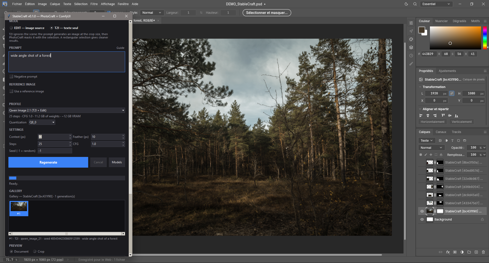
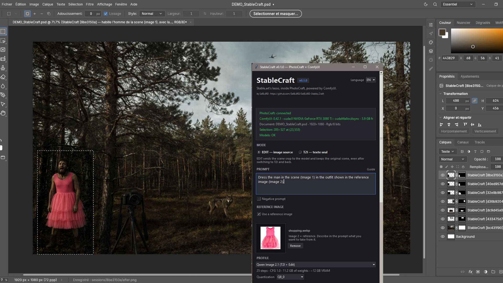
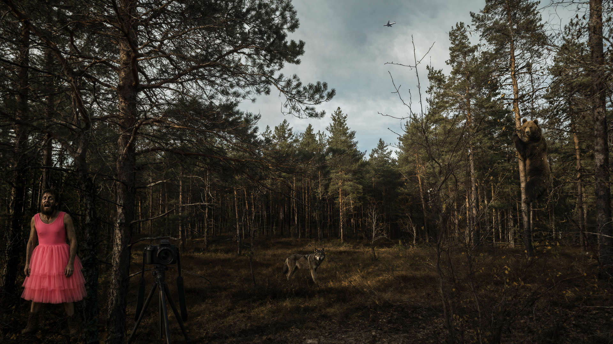

# StableCraft

**L'édition par lasso de Stable.art, dans PhotoCraft, avec ComfyUI.**

StableCraft est une application compagne pour PhotoCraft : on entoure une zone au
lasso, on décrit le changement, et le résultat arrive dans un **nouveau calque masqué**.
Tout tourne en local, sur son propre GPU, avec ComfyUI comme moteur de génération.


**Dépôt :** [github.com/SeBL4RD/SeBL4RD-Stable_Craft](https://github.com/SeBL4RD/SeBL4RD-Stable_Craft)

## Présentation

- lasso → prompt → édition → calque PhotoCraft ;
- calque avec **masque et feather** ;
- **galerie persistante par calque** : régénérer, comparer, changer de génération ;
- régénération possible même si la sélection a été perdue ;
- **deux modes** : EDIT (image source) ou T2I (texte seul), EDIT par défaut ;
- **image de référence par calque** (Krea 2, FLUX.3 Klein et Qwen Image 2.1) ;
- cinq profils : FLUX.3 Klein, FLUX.2 Klein 9B, Krea 2 General Edit
  (base + LoRA), Krea 2 Identity Edit et Qwen Image 2.1 ;
- gestionnaire de modèles à la demande (**Localiser** / **Télécharger**) et vérification
  automatique du nœud `comfyui-krea2edit` ;
- UI anglais/français, anglais par défaut ;
- aucun poids de modèle dans le dépôt ;
- aucun téléchargement silencieux.


<a href="./demo/t2i_forest.png" target="_blank"></a> <a href="./demo/DEMO_StableCraft_EDIT.jpg" target="_blank"></a>


<a href="./demo/DEMO_full.jpg" target="_blank">
  
</a>

## Fondement

StableCraft ne modifie pas PhotoCraft et n'est pas un fork.

PhotoCraft est piloté par son **control channel local** : lecture de la sélection,
sauvegarde du composite, insertion du calque, création du masque. ComfyUI est piloté en
HTTP. Les deux applications restent indépendantes et peuvent être mises à jour
séparément. La compatibilité est vérifiée par les commandes disponibles, pas par un
numéro de version figé.

## Dépendances

### Matériel

- Windows 10/11 **x64**.
- GPU **NVIDIA** seulement, pour le moment.
- **12 Go de VRAM** testés sur RTX 3080 Ti ; 32 Go de RAM.
- En dessous de 12 Go de VRAM, ce n'est pas validé aujourd'hui.

### Logiciel

- **PhotoCraft 0.16.0** ou supérieur (portable ou installé).
- **ComfyUI portable** (avec `python_embeded\python.exe`), récent : `0.42.1+`
  pour Qwen Image 2.1 et les nœuds Krea 2.
- **Python 3.11+** avec **Tkinter** (l'installateur python.org l'inclut).
- Pour Krea 2 : le nœud custom
  [`comfyui-krea2edit`](https://github.com/lbouaraba/comfyui-krea2edit).
- `ComfyUI-GGUF` pour charger les modèles UNet GGUF.

### Modèles

Les poids ne sont **pas** fournis. Ils doivent être visibles par ComfyUI.

| Profil | UNet | Text encoder | VAE | Steps / CFG |
|---|---|---|---|---|
| **FLUX.3 Klein** (défaut) | `flux-3-image-klein-Q8_0.gguf` | `qwen3vl_4b_fp8_scaled.safetensors` | `flux2_vae.safetensors` | 16 / 1.0 |
| **FLUX.2 Klein 9B** | `flux-2-klein-Distilled-9b-Q8_0.gguf` | `Qwen3-8B-Q4_K_M.gguf` | `flux2_vae.safetensors` | 4 / 1.0 |
| **Krea 2 General Edit** | `krea2_turbo_fp8_scaled.safetensors` + `krea2_general_edit_v2.safetensors` | `qwen3vl_4b_fp8_scaled.safetensors` | `qwen_image_vae.safetensors` | 8 / 1.0 |
| **Krea 2 Identity Edit** | `krea2_turbo_edit-Q4_K_M.gguf` | `qwen3vl_4b_fp8_scaled.safetensors` | `qwen_image_vae.safetensors` | 8 / 1.0 |
| **Qwen Image 2.1** | `qwen_image_2.1_Q4_K_M.gguf` (ou Q8_0) | `qwen3vl_8b_w4a8.safetensors` (ou INT8) | `qwen_image_2.1_vae_bf16.safetensors` | 25 / 1.0 |

Notes :

- **Krea 2 EDIT est expérimental** : les résultats sont irréguliers, surtout sur les
  grandes zones. Le profil **General Edit** (base officielle + LoRA) est recommandé
  pour l'édition générale ; le profil **Identity Edit** est un fichier fusionné adapté
  aux personnages. En T2I, Krea 2 General Edit utilise la base seule, sans le LoRA ;
- le GGUF `Qwen3VL-4B-Instruct-Q4_K_M.gguf` testé n'est pas compatible avec FLUX.3
  ni Krea 2 ; StableCraft utilise le FP8 safetensors ;
- `Qwen3-8B-Q4_K_M.gguf` fonctionne pour FLUX.2 ;
- Qwen Image 2.1 utilise un **VAE dédié** (`qwen_image_2.1_vae_bf16.safetensors`) et un
  text encoder **Qwen3-VL-8B**, différents de Krea 2. Le modèle GGUF est proposé en
  Q4_K_M et Q8_0. Le text encoder officiel utilise **W4A8** par défaut
  (`qwen3vl_8b_w4a8.safetensors`, 6,3 Go) au lieu de l'int8 (9,35 Go) : même vision
  encoder, support W4A8 natif dans ComfyUI, environ 3 Go économisés. Choisis **INT8**
  dans le menu de téléchargement pour une fidélité maximale ;
- le GGUF Qwen 2.1 doit contenir la métadonnée d'architecture `qwen_image` attendue par
  `UnetLoaderGGUF`. Les fichiers du dépôt **Unsloth** n'en ont pas et ne sont pas
  chargeables tels quels ; StableCraft pointe vers
  [`Abiray/Qwen-Image-2.1-GGUF`](https://huggingface.co/Abiray/Qwen-Image-2.1-GGUF),
  converti pour ComfyUI-GGUF ;
- Qwen Image 2.1 utilise les nœuds **intégrés** de ComfyUI
  (`TextEncodeQwenImage21`, `QwenImage21Cache`) : aucun nœud custom supplémentaire ;
- Qwen Image 2.1 est sous **licence de recherche non commerciale** ;
- les licences des modèles s'appliquent (FLUX Kommunity, Krea Community, Qwen Research,
  etc.), séparément de la licence MIT du code.

## Installation

### Option 1 — installateur Windows (recommandé)

Double-clique sur **`InstallStableCraft.bat`** à la racine du projet.

L'installateur configure **le dossier courant** : il détecte PhotoCraft et ComfyUI,
crée `user\` et `models\`, écrit `config.toml` si nécessaire et ajoute un raccourci
**StableCraft** sur votre bureau (et menu demarrer).
Lancez votre raccourci StableCraft, il lancera ComfyUI, Photocraft et StableCraft.

Ou, en ligne de commande :

```powershell
powershell -NoProfile -ExecutionPolicy Bypass -File installer\install.ps1
```

Si ComfyUI utilise un autre port, passe `-ComfyEndpoint` ou modifie
`[comfyui] endpoint` dans `config.toml` après l'installation :

```powershell
powershell -NoProfile -ExecutionPolicy Bypass -File installer\install.ps1 `
  -ComfyEndpoint "http://127.0.0.1:12452"
```

### Option 2 — manuel

```powershell
Copy-Item config.example.toml config.toml
.\StableCraft.bat
```

Le lanceur a besoin de `config.toml` ; le plus simple est de copier l'exemple. Les
chemins peuvent rester vides si l'auto-détection suffit. Les chemins importants :

```toml
[photocraft]
executable = "D:/.../photocraft.exe"
control_port = 7990

[comfyui]
endpoint = "http://127.0.0.1:8188"
root = "F:/ComfyUI_windows_portable"
python = "F:/ComfyUI_windows_portable/python_embeded/python.exe"
```

Le port de contrôle par défaut est **7990**. Le port 7878 tombe dans une plage de
ports exclue par Windows sur certaines machines, ce qui fait échouer le control
channel de PhotoCraft avec une erreur de permissions d'accès.

L'endpoint ComfyUI par défaut est **http://127.0.0.1:8188**, le port par défaut de
ComfyUI. Si ton ComfyUI écoute sur un autre port, change `endpoint` :

```toml
[comfyui]
endpoint = "http://127.0.0.1:12452"
```

Quand StableCraft démarre ComfyUI, il ajoute `--port <port de l'endpoint>` au batch
`start_command` si celui-ci ne contient pas déjà un `--port`. Si le batch en contient
un, garde les deux ports identiques ; StableCraft écrit un avertissement dans le
journal en cas de différence.

Au lancement, `StableCraft.bat` :

1. vérifie les chemins ;
2. démarre ComfyUI si nécessaire, **sans ouvrir le navigateur** ;
3. démarre PhotoCraft avec le control channel si nécessaire ;
4. nettoie les fichiers temporaires de « Ouvrir un fichier récent » ;
5. ouvre l'interface.

### Lancer le batch

`StableCraft.bat` est un fichier batch Windows. Double-clique dessus, ou lance-le
avec :

- **cmd.exe** : `StableCraft.bat`
- **PowerShell** : `.\StableCraft.bat`
- **Git Bash / MSYS** : `cmd //c StableCraft.bat`

Ce n'est pas un script Linux/WSL. Le batch utilise `py -3` s'il est disponible,
sinon `python` ; Python **3.11+** et **Tkinter** sont requis. Si aucun ne fonctionne,
il affiche les instructions d'installation au lieu de se fermer sans explication.

Si la fenêtre se ferme immédiatement, lance le batch depuis cmd.exe ou PowerShell
pour lire le message, puis consulte `user\logs\launcher.log`. Utilise l'installateur
python.org (pas l'alias du Microsoft Store) et coche « Add python.exe to PATH ». Si
Windows a bloqué un `.bat` téléchargé, ouvre ses Propriétés et clique **Débloquer**.

Si un chemin obligatoire manque, un message clair s'affiche. Les modèles manquants ne
bloquent pas l'installation : l'UI les signale et **Générer** ouvre le gestionnaire de
modèles avec les actions **Localiser** et **Télécharger**.

## Utilisation

1. Ouvre une image dans PhotoCraft.
2. Fais un **lasso** autour de la zone à modifier.
3. Dans StableCraft : choisis le **mode** (EDIT par défaut, ou T2I), le profil,
   écris le prompt, puis clique **Générer**.
4. Le résultat est ajouté comme **calque StableCraft** avec un masque.
5. La galerie du calque apparaît sous le prompt.

En **T2I**, aucune image de scène n'est envoyée : le prompt génère une image au format
du crop (sélection + contexte), puis PhotoCraft la masque avec la sélection. Une
sélection rectangulaire donne un meilleur résultat qu'un lasso irrégulier. Le `base.png`
de la session reste l'image d'origine : repasser en EDIT sur le même calque utilise
toujours cette scène, jamais l'image T2I précédente. Pour repartir de l'image T2I comme
nouvelle scène, refais un lasso.

### Régénérer et galerie

- Même sélection → **Régénérer** met à jour le **même calque** et ajoute une vignette.
- Chaque génération repart du `base.png` figé au moment du lasso, jamais du composite
  avec les générations précédentes.
- Clique sur une vignette pour appliquer cette génération, sans relancer ComfyUI.
- Sélection perdue → sélectionne le calque `StableCraft [id]`, puis **Régénérer**.
- Nouvelle sélection → nouvelle galerie et nouveau calque.

### Image de référence

- coche **Utiliser une image de référence** ;
- clique sur la vignette ou dépose une image ;
- la référence est propre au calque et se recharge quand tu reviens dessus ;
- compatible **Krea 2**, **FLUX.3 Klein** et **Qwen Image 2.1** ;
- en **EDIT**, le modèle reçoit **image 1 = scène** et **image 2 = référence** ;
- en **T2I**, FLUX.3 Klein et Qwen Image 2.1 utilisent la référence comme image 1
  pour guider une nouvelle image. Krea 2 utilise la référence en EDIT ;
- décris dans le prompt ce que tu prends de la référence.

Exemple :

> Add the black leather glove from the reference image to the man's right hand.
> Keep the hand pose, arm, skin tone, lighting and background unchanged.

Le bouton **Guide** à côté de `PROMPT` ouvre une fenêtre non bloquante avec les bonnes
pratiques et des exemples.

### Aperçu

- **Document** : le composite PhotoCraft après application.
- **Crop** : le résultat généré à la taille du crop, avant masque.

### Modèles et nœud custom

- les fichiers manquants sont listés avec **Localiser** (utiliser un fichier existant)
  et **Télécharger** (taille, source et confirmation) ;
- **Localiser** accepte n'importe quel nom de fichier supporté (**GGUF ou
  safetensors**) : il n'a pas besoin de correspondre au nom attendu dans
  `models.json`. La boîte de dialogue s'ouvre dans le dossier `models` de ComfyUI et
  conserve le nom réel du fichier choisi. Un fichier
  déjà présent dans un dossier de modèles de ComfyUI est utilisé sur place, sans être
  recopié dans le projet. Choisis un UNet/modèle de diffusion seul, pas un checkpoint
  tout-en-un ;
- les choix de quantification sont limités à **Q4_K_M**, **Q8_0** et **BF16** quand le
  modèle les propose ;
- les fichiers téléchargés vont dans `models/` et sont ajoutés à
  `extra_model_paths.yaml` de ComfyUI ;
- après un fichier localisé ou téléchargé, le gestionnaire propose de redémarrer
  ComfyUI automatiquement pour qu'il devienne visible ;
- un fichier déjà dans `models/` est déplacé vers le sous-dossier attendu au lieu
  d'être copié à nouveau ;
- le nœud **comfyui-krea2edit** est vérifié au démarrage et peut être installé ou mis à
  jour depuis le gestionnaire.

## Langue

L'UI prend en charge **l'anglais et le français**. L'anglais est la langue par défaut
d'une nouvelle installation. Utilise le sélecteur de langue dans l'en-tête ; le choix
est enregistré dans `config.toml` (`[app] language`). Redémarre l'UI pour l'appliquer.

La version anglaise de ce README est dans [`README.md`](README.md).

## Mises à jour

StableCraft vérifie la dernière Release GitHub au démarrage. Si une version plus
récente existe, une ligne cliquable apparaît dans l'en-tête et ouvre la page Releases.
Aucun fichier n'est remplacé pendant que l'application tourne : `config.toml`, `user/`
et `models/` sont toujours préservés, et la mise à jour reste une action explicite.

## Stockage

Rien n'est stocké dans AppData.

```text
<dossier StableCraft>/
  user/
    control.token
    sessions/<id>/       # base, masque, référence, galerie
    logs/
    model_selection.json # quantification choisie par profil
  models/                # modèles locaux, aucun poids versionné
```

Les chemins sont configurables dans `config.toml` (`[app]`, `[photocraft]`,
`[comfyui]`, `[models]`).

## Crédits

- **Stable.art** — inspiration pour l'expérience lasso + prompt.
- **PhotoCraft** — application hôte et control channel :
  [storytold/photocraft](https://github.com/storytold/photocraft).
- **ComfyUI** — moteur de génération :
  [comfyanonymous/ComfyUI](https://github.com/comfyanonymous/ComfyUI).
- **FLUX.3 Klein / FLUX.2 Klein** — Black Forest Labs.
- **Krea 2** — Krea.
- **Qwen** — équipe Qwen, Alibaba.
- **ComfyUI-GGUF** — [city96/ComfyUI-GGUF](https://github.com/city96/ComfyUI-GGUF).
- **comfyui-krea2edit** — [lbouaraba/comfyui-krea2edit](https://github.com/lbouaraba/comfyui-krea2edit).

StableCraft n'est affilié ni à Stable.art, ni à PhotoCraft, ni à ComfyUI, ni aux
fournisseurs de modèles.

## Licence

Le code de StableCraft est sous licence **MIT** (voir [`LICENSE`](LICENSE)).
Les modèles, ComfyUI et PhotoCraft conservent leurs licences respectives. Aucun poids
de modèle n'est distribué dans ce dépôt.
