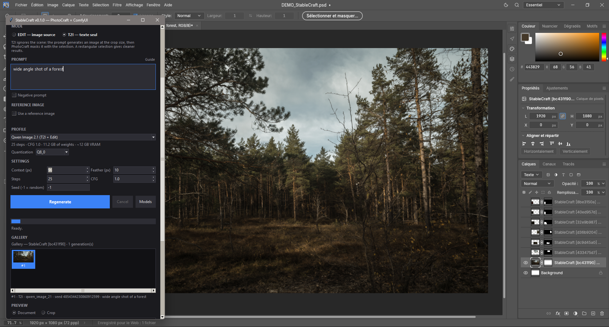
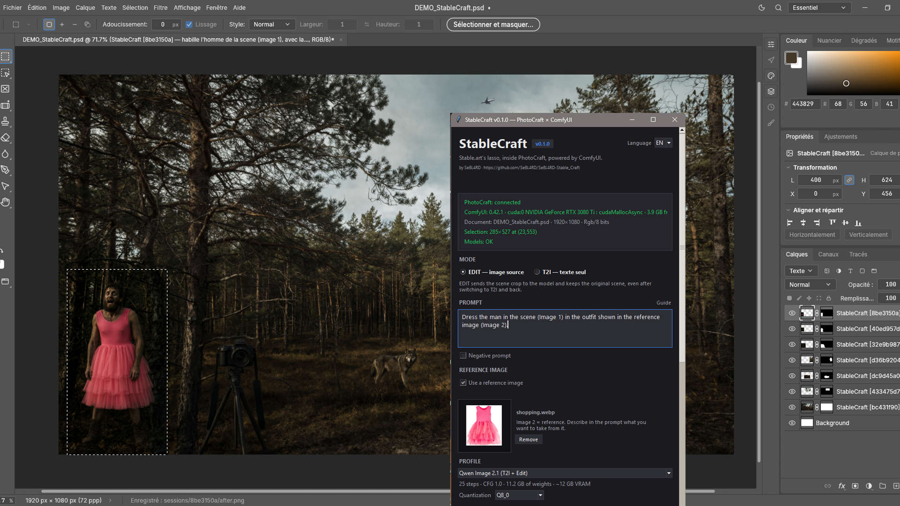
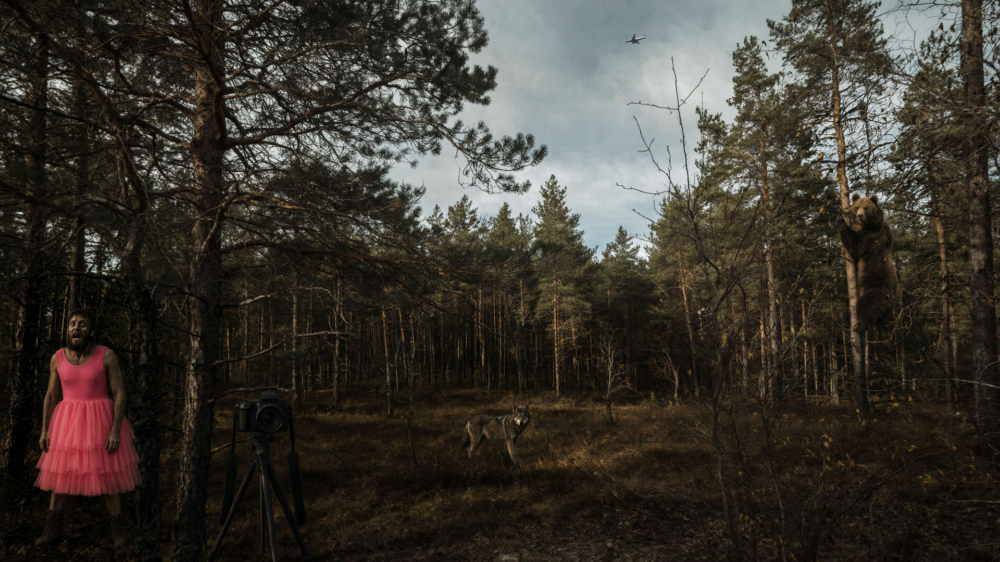

# StableCraft

**Stable.art's lasso editing, inside PhotoCraft, powered by ComfyUI.**

StableCraft is a companion app for PhotoCraft: draw a lasso around an area, describe
the change, and the result arrives as a **new masked layer**. Everything runs locally
on your own GPU, with ComfyUI as the generation engine.


## Highlights

- lasso → prompt → edit → PhotoCraft layer;
- layer with **mask and feather**;
- **persistent gallery per layer**: regenerate, compare, switch generations,
  favorites;
- batch up to 16 images, applied as they finish;
- **XYZ plot** tool (sampler, scheduler, steps, denoise, LoRA, CFG, prompt S/R);
- reference image;
- regeneration works even after the selection is lost;
- **two modes**: EDIT (source image) or T2I (text only), EDIT by default;
- **LoRA management** with an ergonomic UI and thumbnails;
- **6 models available** for now;
- on-demand model manager (**Locate** / **Download**) and automatic check for the
  required custom nodes;
- English/French UI, English by default.


<a href="./demo/t2i_forest.png" target="_blank"></a> <a href="./demo/DEMO_StableCraft_EDIT.jpg" target="_blank"></a>


<a href="./demo/DEMO_full.jpg" target="_blank">
  
</a>

## How it works

StableCraft does not modify or fork PhotoCraft.

PhotoCraft is driven through its **local control channel**: reading the selection,
saving the composite, inserting the layer and creating the mask. ComfyUI is driven over
HTTP. Both applications stay independent and can be updated separately. Compatibility is
checked through the commands exposed by each build, not through a fixed version number.

## Requirements

### Hardware

- Windows 10/11 **x64**, or Linux **x86_64**.
- **NVIDIA** GPU only, for now.
- **12 GB of VRAM** tested on an RTX 3080 Ti; 32 GB of RAM.
- Below 12 GB of VRAM is not validated today; MOSS INT8 may fit in 12 GB with
  ComfyUI offloading.
- On Linux, AMD/ROCm may work through ComfyUI but is not validated by StableCraft.

### Software

- **PhotoCraft 0.16.0** or newer.
- **ComfyUI** recent enough: `0.42.1+` for Qwen Image 2.1 and Krea 2,
  `0.43+` for MOSS-Image EDIT.
- **Python 3.11+** with **Tkinter**.

### Models

Weights are **not** bundled. They must be visible to ComfyUI. StableCraft can locate
or download missing files on demand, with explicit confirmation.

| Profile | UNet | Text encoder | VAE | Steps / CFG |
|---|---|---|---|---|
| **FLUX.3 Klein** (default) | `flux-3-image-klein-Q8_0.gguf` | `qwen3vl_4b_fp8_scaled.safetensors` | `flux2_vae.safetensors` | 16 / 1.0 |
| **FLUX.2 Klein 9B** | `flux-2-klein-Distilled-9b-Q8_0.gguf` | `Qwen3-8B-Q4_K_M.gguf` | `flux2_vae.safetensors` | 4 / 1.0 |
| **Krea 2 General Edit** | `krea2_turbo_fp8_scaled.safetensors` + `krea2_general_edit_v2.safetensors` | `qwen3vl_4b_fp8_scaled.safetensors` | `qwen_image_vae.safetensors` | 8 / 1.0 |
| **Krea 2 Identity Edit** | `krea2_turbo_edit-Q4_K_M.gguf` (Q6_K / Q8_0 available) | `qwen3vl_4b_fp8_scaled.safetensors` | `qwen_image_vae.safetensors` | 8 / 1.0 |
| **Qwen Image 2.1** | `qwen_image_2.1_Q4_K_M.gguf` (or Q8_0) | `qwen3vl_8b_w4a8.safetensors` (or INT8) | `qwen_image_2.1_vae_bf16.safetensors` | 25 / 1.0 |
| **MOSS-Image SFT** | `moss_image_sft_int8_convrot.safetensors` | `qwen3.5_9b_w4a8_gptq.safetensors` (or W4A8 5.4 GB / INT8) | `flux2-vae_small.safetensors` | 50 / 3.0 (T2I) · 30 / 4.0 (EDIT) |

Notes:

- **Krea 2 EDIT is experimental**; prefer **General Edit** (base + LoRA) for general
  edits and **Identity Edit** for characters. In T2I, General Edit uses the base alone.
- The tested `Qwen3VL-4B-Instruct-Q4_K_M.gguf` GGUF is not compatible with FLUX.3 or
  Krea 2; use the FP8 file.
- Qwen Image 2.1 uses a dedicated VAE and a Qwen3-VL-8B text encoder. W4A8 is the
  default (6.3 GB); INT8 (9.35 GB) is available for maximum fidelity.
- **MOSS-Image** uses the native ComfyUI INT8 path. W4A8 is the
  default text encoder; the 5.4 GB W4A8 is lighter but community-built, INT8 is
  maximum fidelity. EDIT loads a 297 MB LoRA (GPL-3.0) and needs ComfyUI 0.43+.
  A full scene caption works best; the optional prompt enhancer is not included.
  The community 8-step LoRA is not bundled.

---

## Installation

StableCraft runs from the project folder.

### Installation Windows

Double-click **`InstallStableCraft.bat`** at the repository root.

The installer configures **the current folder**: it detects PhotoCraft and ComfyUI,
creates `user\` and `models\`, writes `config.toml` when needed and adds a
**StableCraft** shortcut. It does not copy anything to AppData or another folder, and
does not download any model.

Once installed, double-click **`StableCraft.bat`** at the repository root (or the
**StableCraft** shortcut) to launch it.

Command line:

```powershell
powershell -NoProfile -ExecutionPolicy Bypass -File installer\install.ps1
```

If ComfyUI uses a non-default port, pass `-ComfyEndpoint` or edit
`[comfyui] endpoint` in `config.toml` after installation:

```powershell
powershell -NoProfile -ExecutionPolicy Bypass -File installer\install.ps1 `
  -ComfyEndpoint "http://127.0.0.1:12452"
```

### Installation Linux

Debian/Ubuntu, Fedora/RHEL and Arch are supported. StableCraft uses a **local venv**
on Linux. Python 3.11+ and Tkinter are required; older distributions are intentionally
not supported.

```bash
bash install.sh
```

The installer installs any missing system packages (Python, Tkinter, venv),
creates `.venv`, installs `prototypes/requirements.txt`, creates `config.toml`
if needed, and adds an application shortcut. It asks before using `sudo`; use
`bash install.sh --yes` for a non-interactive install. It does **not** download
models or modify ComfyUI. Launch with `./StableCraft.sh` or the application
shortcut.

Linux dependencies (installed automatically when missing):

| Distribution | Packages |
|---|---|
| Debian / Ubuntu / Mint | `python3 python3-tk python3-venv` |
| Fedora / RHEL / Rocky / Alma | `python3 python3-tkinter` |
| Arch / Manjaro | `python tk` |

Python **3.11+** is mandatory because StableCraft uses `tomllib`. This excludes
Ubuntu 22.04 (Python 3.10) and RHEL 9 (Python 3.9) unless a newer Python is installed.

> **Fedora 45+ (Python 3.15):** StableCraft itself installs and runs with Python
> 3.15. ComfyUI's dependencies do not all ship Python 3.15 wheels yet
> (`sentencepiece`, `kornia-rs`); use Fedora's `python3.13` (or `python3.14`) for
> ComfyUI's venv.

On Linux, `manage = false` is the default; start ComfyUI yourself.

```toml
[comfyui]
endpoint = "http://127.0.0.1:8188"
manage = false
```

To let StableCraft start it, set `manage = true` and point to the install:

```toml
[comfyui]
endpoint = "http://127.0.0.1:8188"
manage = true
root = "/home/seb/ComfyUI-Installs/ComfyUI"
python = "/home/seb/ComfyUI-Installs/ComfyUI/.venv/bin/python"
# Optional; otherwise <root>/ComfyUI/main.py or <root>/main.py is used.
start_command = ""
# Open a visible terminal for ComfyUI (falls back to the log without a display).
open_console = true
# Extra arguments for main.py. On a CPU-only VM/without CUDA:
# extra_args = ["--cpu"]
extra_args = []
```

`open_console` opens a desktop terminal when available; otherwise StableCraft writes
`user/logs/comfyui.log`.

PhotoCraft is detected automatically on Linux. If detection fails, set `executable`
manually:

```toml
[photocraft]
executable = "/usr/bin/photocraft"
control_port = 7990
```

Prefer the AppImage, `.deb`, `.rpm` or tarball; the Flatpak sandbox can block
`automation_root`.

If ComfyUI does not see models downloaded by StableCraft, set the installation
folder in `[comfyui] root`: StableCraft will add `extra_model_paths.yaml` there.

### Configuration

The installer creates `config.toml` for you. Paths can stay empty when auto-detection
is enough. The important paths are:

```toml
[photocraft]
executable = "D:/.../photocraft.exe"
control_port = 7990

[comfyui]
endpoint = "http://127.0.0.1:8188"
root = "F:/ComfyUI_windows_portable"
python = "F:/ComfyUI_windows_portable/python_embeded/python.exe"
```

StableCraft uses control port **7990** by default.

The default ComfyUI endpoint is **http://127.0.0.1:8188**, ComfyUI's own default.
If ComfyUI listens on another port, change `endpoint`:

```toml
[comfyui]
endpoint = "http://127.0.0.1:12452"
```

If it crashes, check `user/logs/` (`launcher.log`, `ui.log`, `comfyui.log`).
Missing paths show a clear message; missing models are reported by the UI and open
the model manager.

## Usage

Lasso → prompt → **Generate**; the result becomes a masked StableCraft layer.
In **T2I**, the prompt generates an image at the crop size, then PhotoCraft masks it;
a rectangular selection is preferable.

Persistent memory per layer: previous generations and settings are remembered.

### Settings

- **Sampler / Scheduler**: values from ComfyUI; `euler` + `simple` by default.
- **Denoise**: only **EDIT + FLUX.2 Klein 9B**; forced to `1.0` everywhere else.
- Settings are stored per generation; changing them invalidates duplicate detection.

### Gallery and batch

- **Regenerate** updates the same layer; every generation stays in the gallery.
- **Favorites**: the star is stored in `session.json`.
- **Batch**: fixed seed → `seed`, `seed+1`, …; `-1` → random. Each image is
  applied as soon as it is ready.

### XYZ plot

- Separate tool; never writes into the current layer.
- Axes: Sampler, Scheduler, Steps, Denoise (FLUX.2 Klein 9B EDIT), LoRA, CFG,
  Prompt S/R, Negative prompt S/R.
- Comma-separated values; ranges `5-15(+2)` or `5-15[5]`.
- **Prompt S/R**: first value = search text, all values = replacements
  (prompt + negative). **Negative prompt S/R**: negative only.
- X = columns, Y = rows, Z = sub-grids side by side; **fixed seed**.
- Output: `user/xyz/<run>/` (`plot.png`, `plot_z*.png`, `cells/`, `job.json`,
  `cells.json`).

### Reference image

You can add a reference image; click **Guide** if needed.

### LoRA

- **Up to 10 per profile**, strength 0–1, stored per profile and copied into
  `session.json`.
- Folder navigation and thumbnails in the picker; StableCraft never copies model
  files.
- A persistent **Blur NSFW LoRA** checkbox blurs mature previews in both the
  manager and the picker.
- The manager warns on architecture mismatch without blocking.

## Storage

`user/` holds sessions, XYZ runs, pending references, LoRA previews and logs;
`models/` holds model files.

## Language

English/French, selector in the header, saved in `config.toml` (`[app] language`),
restart required.

## Updates

Checks the latest GitHub Release at startup. `git pull` also updates the project if
you downloaded it with git.

## Support

Want to support my work? Buy me a Ko-fi! :)

[](https://ko-fi.com/sebl4rd)

[ko-fi.com/sebl4rd](https://ko-fi.com/sebl4rd)

## Credits

- **Stable.art** — inspiration for the lasso + prompt experience:
  [isekaidev/stable.art](https://github.com/isekaidev/stable.art).
- **PhotoCraft** — host application and control channel:
  [storytold/photocraft](https://github.com/storytold/photocraft).
- **ComfyUI** — generation engine:
  [comfyanonymous/ComfyUI](https://github.com/comfyanonymous/ComfyUI).
- **FLUX.3 Klein / FLUX.2 Klein** — Black Forest Labs.
- **Krea 2** — Krea.
- **Qwen** — Qwen team, Alibaba.
- **MOSS-Image** — OpenMOSS team, edit LoRA by
  [chinoll](https://huggingface.co/chinoll/Moss-Image-Edit).
- **ComfyUI-GGUF** — [city96/ComfyUI-GGUF](https://github.com/city96/ComfyUI-GGUF).
- **comfyui-krea2edit** — [lbouaraba/comfyui-krea2edit](https://github.com/lbouaraba/comfyui-krea2edit).

StableCraft is not affiliated with Stable.art, PhotoCraft, ComfyUI or any model provider.

## License

StableCraft code is released under the **MIT** license (see [`LICENSE`](LICENSE)).
Models, ComfyUI and PhotoCraft keep their own licenses. No model weights are
distributed in this repository.
